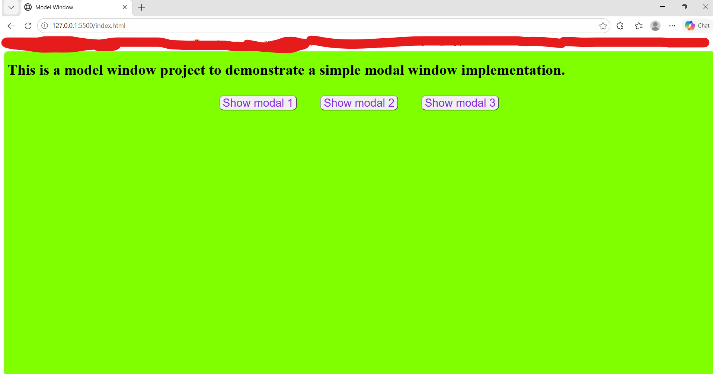
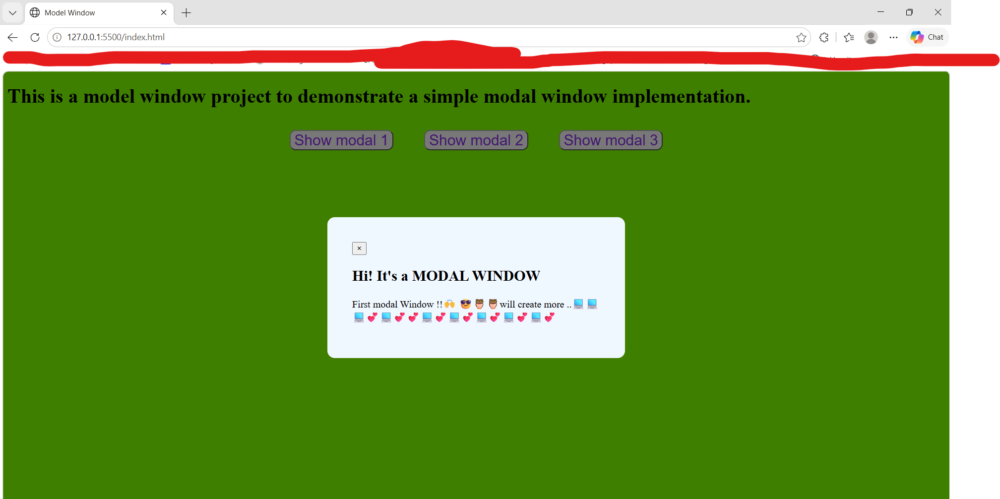

# Modal Window — JavaScript DOM Project

A simple, interactive modal window application built using HTML, CSS, and vanilla JavaScript to practice DOM manipulation, event handling, and reusable functions.

## Features

- Open a modal using any of the three buttons.
- Close the modal using the close (×) button.
- Close the modal by clicking on the overlay.
- Close the modal by pressing the Escape key.
- Reusable `openModal()` and `closeModal()` functions.

## Tech Stack

- HTML5
- CSS3
- JavaScript (ES6+)

## Concepts Practiced

- DOM selection using `querySelector()` and `querySelectorAll()`
- Event listeners (`click`, `keydown`)
- Keyboard event handling using `event.key`
- CSS class manipulation using `classList`
- Conditional logic and logical operators
- Function references and reusable functions
- DRY (Don't Repeat Yourself) principle

## Project Preview

## Project Preview

### Modal Closed

### Modal Open

## Live Demo

Deployment link coming soon.

## Run Locally

1. Clone this repository.
2. Open the project folder.
3. Open `index.html` in a browser, or use the VS Code Live Server extension.

## What I Learned

This project helped me understand how to handle multiple DOM events, control UI visibility, debug keyboard interactions, and organize repeated logic into reusable functions.
